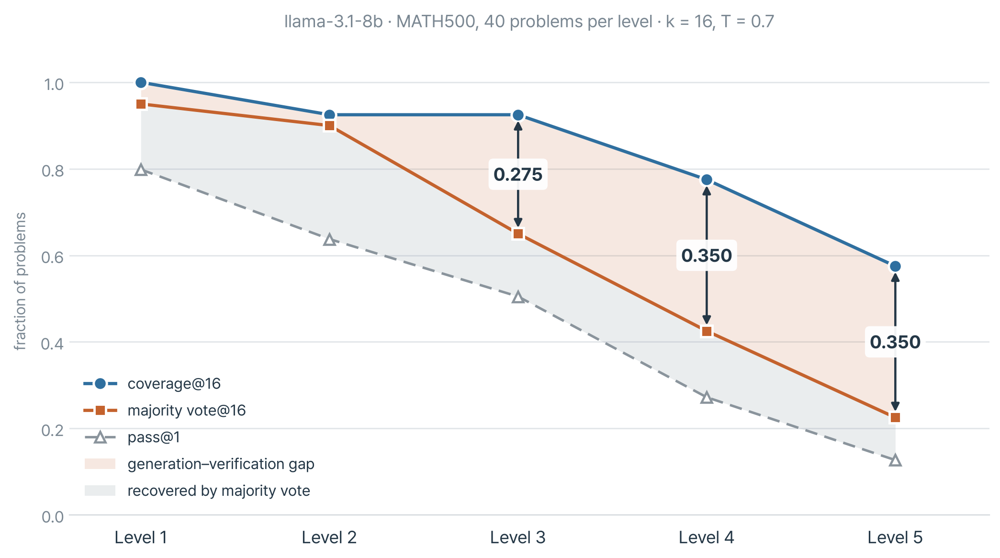
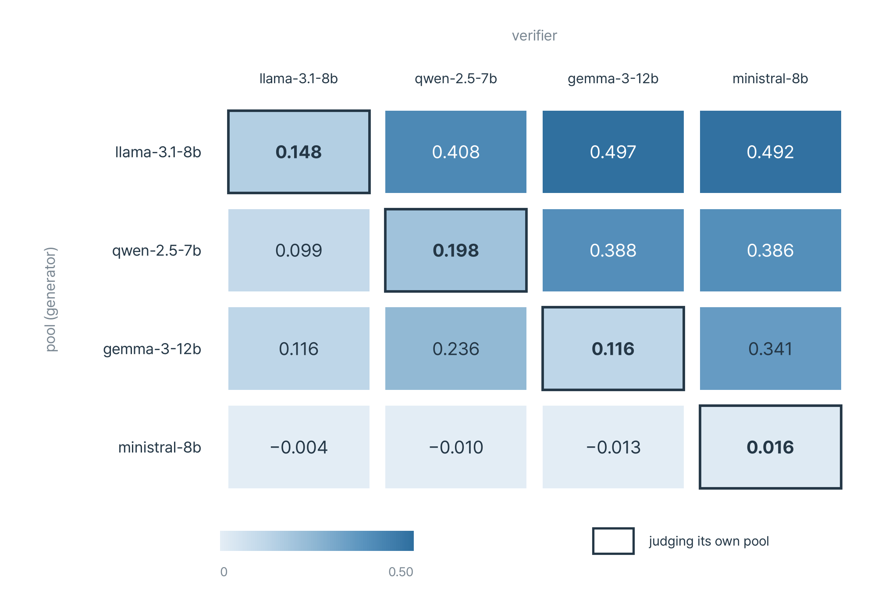
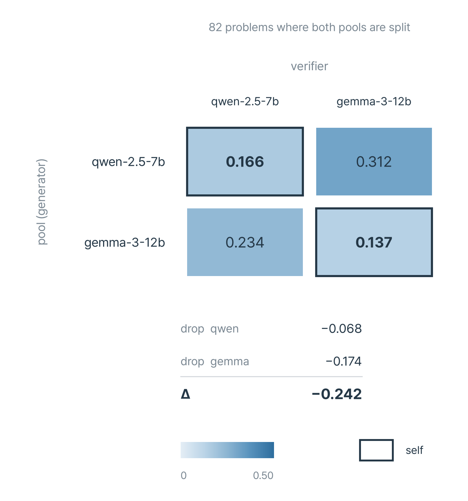

# Do small LLM verifiers go easy on their own answers?

Four 7–12B instruct models each wrote 16 solutions to every MATH500 problem, and each model then judged every model's solutions, one candidate at a time. Of the six model pairs, the design could cleanly test only one: **qwen-2.5-7b × gemma-3-12b**. There, both models lose discrimination when they grade their own pool (**Δ = −0.242**; all 2,000 bootstrap resamples negative). The loss comes from saying *Yes* more often to their own output, about twice as much on wrong answers as on right ones. That looks like a lower bar for familiar output, not better recognition of their own correct work.

This is a small, independent measurement from a self-study of Stanford CS329A, not a claim of novelty. See [Related work](#related-work).

## Why this question

Sampling many answers and picking one works only if the picker can tell right from wrong. On llama-3.1-8b over 200 level-balanced MATH500 problems, at least one of 16 samples is correct on **84.0%** of problems, but majority vote finds it on **63.0%**. The difference, the generation–verification gap, opens from level 3 onward:

<p align="center"></p>

| Level | 1 | 2 | 3 | 4 | 5 | all |
|---|---|---|---|---|---|---|
| pass@1 | .798 | .637 | .505 | .272 | .127 | .468 |
| majority@16 | .950 | .900 | .650 | .425 | .225 | .630 |
| coverage@16 | 1.000 | .925 | .925 | .775 | .575 | .840 |
| **gap** | .050 | .025 | **.275** | **.350** | **.350** | **.210** |

One way to close the gap is to ensemble several weak verifiers, as in Weaver. Ensembling helps when the verifiers' errors are independent of the candidates. If a verifier is more lenient on its own model's output, and that model is also the generator, its errors line up with the candidates instead of averaging out. Whether that happens for models of **similar size from different families** came up in CS329A (Lecture 3) and was left open. This repo measures it.

## Setup

| | Generator and verifier | Host pinned on OpenRouter |
|---|---|---|
| llama | `meta-llama/llama-3.1-8b-instruct` | DeepInfra (generation), Novita / CoreWeave (verification) |
| qwen | `qwen/qwen-2.5-7b-instruct` | Phala |
| gemma | `google/gemma-3-12b-it` | DeepInfra |
| ministral | `mistralai/ministral-8b-2512` | Mistral |

These are all the general-purpose, non-reasoning instruct families in the 6–12B range that OpenRouter served in September 2026, one model per family. (The one other family in that range, IBM Granite, is a reasoning model and was left out.)

- **Problems.** All 500 MATH500 test problems.
- **Generation.** 16 samples per problem, T = 0.7, max 2,048 tokens. 32,000 responses.
- **Labels.** A rule-based checker ([`src/verifier.py`](src/verifier.py)) compares the last `\boxed{}` answer with the reference. No model is involved.
- **Verification.** Each verifier sees one problem and one candidate and answers a single token, *Yes* or *No*, at temperature 0. It never sees the other candidates. 40,320 calls.
- **Hosts.** OpenRouter can serve one model id from several hosts with different quantisation. At temperature 0, verdicts still flipped across hosts, so every call names its host and the host that served it is recorded.
- **Scored candidates.** Only candidates with a `\boxed{}` answer, on problems where those candidates are neither all right nor all wrong. That is where D is defined at all.

## Measures

**Discrimination** of verifier V on generator G's pool:

```
D(G, V) = P(Yes | correct candidate) − P(Yes | wrong candidate)  =  TPR − FPR
```

D = 0 means the verdict carries no information about correctness.

**Interaction** for a pair of models A and B:

```
Δ(A, B) = [ D(A,A) − D(B,A) ]  +  [ D(B,B) − D(A,B) ]
            drop of verifier A        drop of verifier B
            on its own pool           on its own pool
```

Each bracket is how much one verifier's discrimination drops when it grades its own pool instead of the other's. A single bracket mixes that drop with how hard the two pools are to judge. The difficulty gap enters the two brackets with opposite signs, so only their sum is free of it. Δ is the standard 2 × 2 interaction contrast (difference-in-differences), so verifier strength and pool difficulty cancel algebraically.

Δ is computed only on problems that both pools score. Subtracting cells of the full matrix below gives a different number, because those cells sit on different problem sets.

## Results

### The full matrix

<p align="center"></p>

Main effects dominate. Verifier means run from 0.090 (llama) to 0.309 (ministral), and pool means from −0.002 (ministral) to 0.386 (llama). The diagonal cells can't be compared directly, which is why the analysis uses Δ.

### Only one pair could be tested

| Pair | shared problems | Δ | bootstrap 95% CI | per-problem mean, t 95% CI | verdict |
|---|---|---|---|---|---|
| **qwen × gemma** | 82 | **−0.242** | [−0.336, −0.151] | −0.237 [−0.362, −0.112] | **claimable** |
| llama × qwen | 130 | −0.106 | [−0.191, −0.026] | −0.024 [−0.117, +0.070] | no claim: estimators disagree |
| llama × gemma | 58 | −0.089 | [−0.271, +0.098] | +0.007 [−0.154, +0.169] | null |
| llama × ministral | 20 | −0.420 | [−0.539, −0.258] | −0.188 [−0.429, +0.054] | undecidable |
| qwen × ministral | 20 | −0.070 | [−0.243, +0.101] | −0.116 [−0.313, +0.081] | undecidable |
| gemma × ministral | 11 | +0.037 | [−0.181, +0.227] | −0.085 [−0.437, +0.268] | undecidable |

A pair is claimable only if both interval estimates exclude 0 and the pair shares at least 40 problems. That rule was fixed before the 500-problem run.

The five other pairs fail for two different reasons, and neither is an absence of effect.

- **llama as a verifier has no range.** It passes 78–100% of wrong answers. On the 45 problems that the llama, qwen and gemma pools share, its D moves only 0.047 across pools, against 0.102 for qwen and 0.181 for gemma. Each bracket of Δ is bounded by that verifier's range, so |Δ(llama, qwen)| ≤ 0.149 and |Δ(llama, gemma)| ≤ 0.228. Neither pair could have shown an effect of the size measured for qwen × gemma.
- **ministral as a generator leaves nothing to judge.** It answers in `\boxed{}` only 71% of the time, but 97% of those answers are correct. Only 29 problems and 88 wrong candidates survive, and every verifier, ministral included, accepted 97–100% of both its right and its wrong candidates.

So 3 of the 6 pairs contain llama and 3 contain ministral. qwen × gemma is the only pair free of both.

### qwen × gemma

<p align="center"></p>

Both drops are negative. A difference in pool difficulty would push them in opposite directions, so it cannot produce this pattern.

| Verifier | Pool | TPR | FPR | D |
|---|---|---|---|---|
| qwen | gemma | 0.870 | 0.636 | 0.234 |
| | **qwen (own)** | **0.918** | **0.752** | **0.166** |
| | own − other | +0.048 | +0.116 | −0.068 |
| gemma | qwen | 0.742 | 0.430 | 0.312 |
| | **gemma (own)** | **0.961** | **0.824** | **0.137** |
| | own − other | +0.220 | +0.394 | −0.174 |

On its own pool, each verifier says *Yes* more often to everything, and the rise on wrong answers is 1.8–2.4 times the rise on right ones. If a model recognised its own correct reasoning, TPR would rise and FPR would not. Both rise. **It is less likely to doubt its own style, not better at judging it.**

The better verifier loses more: gemma's D falls from 0.312 to 0.137 (−56%) and qwen's from 0.234 to 0.166 (−29%). In an ensemble, the verifier you would most want to include is the one most affected when its own generations are in the pool.

## What this does not show

- **Scope.** One pair, one benchmark, one judging prompt, 7–12B non-reasoning models.
- **Candidate difficulty.** Δ controls for which problems are compared, not for which candidates. On a shared problem, qwen's wrong answers and gemma's wrong answers are different objects. One check argues against an artefact: qwen rejects gemma's wrong answers more easily (FPR 0.636) than its own (0.752).
- **Generation noise.** The bootstrap resamples problems, not generations. Re-sampling the 16 candidates at T = 0.7 would widen the intervals by an unmeasured amount.
- **Threshold or discrimination.** A shifted acceptance threshold and genuinely worse separation look the same at a single operating point. Telling them apart needs a ROC curve, and no host served logprobs for qwen or gemma. At the operating point a pipeline would actually use, the verifier still passes more of its own wrong answers.
- **Post hoc.** The range argument for llama was worked out after the results came in. A better design measures each candidate verifier's range in a pilot before choosing the pool.
- **Hosts.** llama as a verifier was served by two hosts. Split by host, its D differs by at most 0.022 per pool. See [results/summary.md](results/summary.md).

## Reproduce

Python 3.11. On 3.13 the symbolic answer checker's dependencies fail to import.

```bash
python3.11 -m venv .venv && source .venv/bin/activate
pip install -r requirements.txt

# archived responses, labels and verdicts (10 MB): Releases → v1.0 → data_4x4.tar.gz
tar xzf data_4x4.tar.gz          # fills data/raw/

python -m src.analyze            # every number above, no API calls → results/
python -m pytest                 # checks the reported numbers against the data
jupyter notebook figures.ipynb   # redraws figures/
```

To generate and judge from scratch, which costs money:

```bash
pip install datasets
python scripts/build_problems.py --check   # MATH500 in experiment order; relabels archived pools as a check
cp .env.example .env                       # add OPENROUTER_API_KEY
python -m src.generate --model qwen        # ~8,000 calls per generator, resumable
python -m src.judge --all                  # ~40,000 calls, resumable
python -m src.analyze
```

## Layout

```
src/
  config.py         models, hosts, prompts, sampling settings
  verifier.py       rule-based correctness labels
  openrouter.py     HTTP client, host pinned on every call
  generate.py       16 samples per problem + labels
  judge.py          one Yes/No verdict per candidate
  data.py           loading, and which candidates are scored
  analyze.py        D, Δ, intervals, every table in results/summary.md
  figures.py        the three figures
scripts/build_problems.py
tests/              checker unit tests + regression test on the archived data
results/            results.json, summary.md (generated)
figures/            png + svg (generated)
third_party/        symbolic answer equivalence (see NOTICE.md)
```

## Related work

- Brown et al., 2024. *Large Language Monkeys: Scaling Inference Compute with Repeated Sampling.* (coverage vs. selection)
- Saad-Falcon et al., 2025. *Weaver: Shrinking the Generation-Verification Gap with Weak Verifiers.*
- Panickssery et al., 2024. *LLM Evaluators Recognize and Favor Their Own Generations.* NeurIPS. (summarisation; Llama-2-7B near chance at self-recognition)
- Chen et al., 2025. *Do LLM Evaluators Prefer Themselves for a Reason?* arXiv:2504.03846. (MATH500 with Qwen, Llama and Gemma evaluators. The closest setting to this one.)

## Acknowledgements and licence

This started from the Stanford CS329A (Fall 2025) Homework 1 starter code, which I worked through as a self-study. The repository contains none of the assignment's solutions. `third_party/math_utils.py` comes from that starter code; see [third_party/NOTICE.md](third_party/NOTICE.md). Problems are from [HuggingFaceH4/MATH-500](https://huggingface.co/datasets/HuggingFaceH4/MATH-500). Model outputs in the data release remain subject to each model's licence.

Code: MIT.
